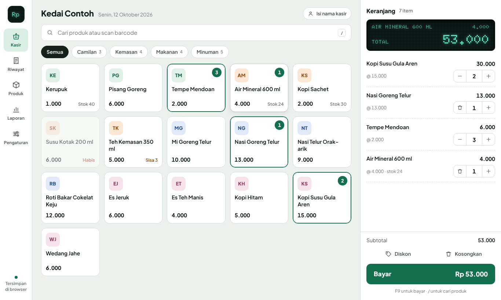
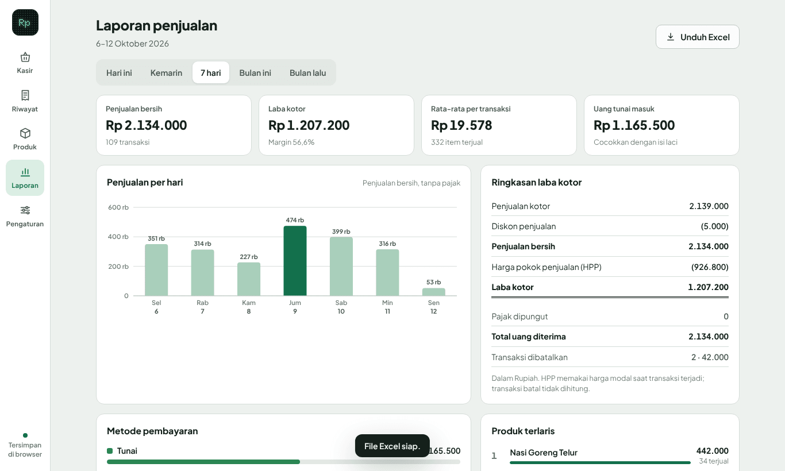
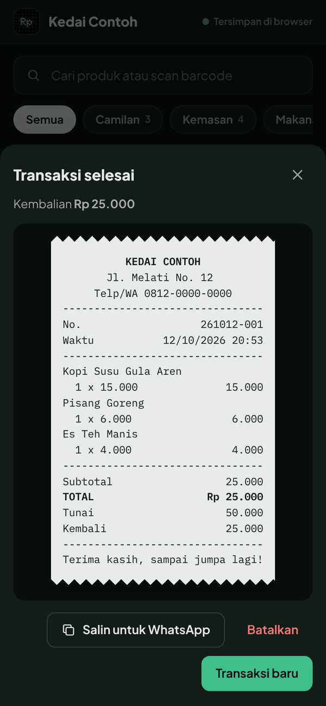

# Kasir Warung

Aplikasi kasir sederhana untuk warung, kedai, dan toko kecil. Cukup satu file `index.html` yang langsung jalan di browser HP atau laptop, tanpa instalasi dan tanpa server.

## Fitur

- **Kasir**: ketuk produk atau scan barcode, beri diskon (Rupiah atau persen), pajak opsional, lalu bayar dengan Tunai, QRIS, atau Transfer. Tombol pecahan uang memakai warna uang kertas rupiah, dan kembalian dihitung otomatis.
- **Struk**: format kertas thermal 58 mm yang bisa disalin langsung ke chat WhatsApp.
- **Riwayat**: semua transaksi dikelompokkan per hari. Transaksi yang dibatalkan wajib diberi alasan dan tetap tercatat dengan tanda BATAL, tidak dihapus.
- **Produk & stok**: harga jual, harga modal (HPP), margin, peringatan stok menipis, stok masuk/keluar, dan stok opname.
- **Laporan**: penjualan bersih, laba kotor (penjualan kotor − diskon − HPP), rincian metode pembayaran, produk terlaris, grafik per hari atau per jam, dan unduh Excel.
- **Cadangan**: unduh dan pulihkan seluruh data dalam satu file.

## Cara pakai

1. Buka link GitHub Pages repo ini (lihat bagian di bawah), atau unduh `index.html` lalu buka di browser.
2. Saat pertama dibuka, aplikasi berisi data contoh. Coba-coba dulu, lalu klik **Hapus data contoh**.
3. Atur nama toko, alamat, dan pesan struk di **Pengaturan**, lalu tambahkan produkmu di **Produk**.

Pintasan keyboard: `/` untuk mencari produk, `F9` untuk bayar. Menekan `Enter` di kolom cari langsung memasukkan produk yang kodenya cocok, jadi scanner barcode USB bisa langsung dipakai.

## Penyimpanan data

Data disimpan di browser perangkat yang dipakai (localStorage). Artinya:

- Tidak perlu login atau server, dan data tidak dikirim ke mana pun.
- Data di HP dan di laptop terpisah. Pindahkan lewat **Pengaturan → Unduh cadangan**, lalu **Pulihkan dari file** di perangkat lain.
- Membersihkan data browser juga menghapus data kasir, jadi unduh cadangan secara berkala.

## Mengaktifkan GitHub Pages

Buka **Settings → Pages**, pada bagian *Build and deployment* pilih Source **Deploy from a branch**, Branch **main** dengan folder **/ (root)**, lalu **Save**. Setelah satu atau dua menit, aplikasi bisa dibuka di `https://verddf.github.io/kasir-warung/`.

## Teknologi

HTML, CSS, dan JavaScript tanpa framework. Font dimuat dari Google Fonts (Plus Jakarta Sans, IBM Plex Mono, Doto), dan ekspor Excel memakai SheetJS dari CDN cdnjs. Keduanya butuh koneksi internet saat halaman dibuka. Tanpa internet, aplikasi tetap bisa dipakai dengan font bawaan perangkat, tetapi tombol Unduh Excel tidak berfungsi.
